# MacAmp

Un reproductor de música para Mac al estilo de Winamp: una ventana pequeña con espectro y ecualizador, una biblioteca para tus archivos de música, listas de reproducción y radio por internet gratis con grabación.

[English](README.md) | Español

<p align="center">
  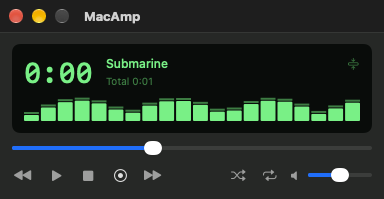
  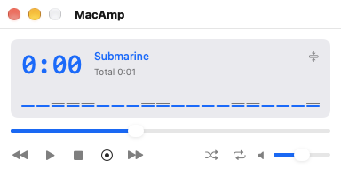
</p>

Escrito en Swift y SwiftUI para macOS 26 o posterior. Usa solo frameworks de Apple: sin código de terceros.

## Funciones

**Reproducción**
- Archivos MP3, AAC, ALAC, FLAC, WAV y AIFF, sin pausa entre pistas del mismo formato.
- Una cola que reordenas arrastrando, con aleatorio, repetir y deshacer.
- Un ecualizador de 10 bandas con preamplificador y preajustes, y un espectro de 20 barras en vivo.
- ReplayGain: pistas con volumen parecido según las etiquetas de ganancia de archivos MP3 y M4A.
- Teclas multimedia, Ahora suena en el Centro de control y atajos globales que funcionan aunque otra app esté al frente.

**Biblioteca y listas**
- Agrega carpetas de música; MacAmp lee sus etiquetas y las vigila por si cambian.
- Búsqueda, navegador por columnas de género, artista y álbum, columnas ordenables y personalizables, un inspector con la carátula y un buscador de duplicados.
- Listas de reproducción donde arrastras pistas; importa y exporta M3U, M3U8 y PLS.

**Radio por internet**
- Busca en el directorio gratuito [Radio Browser](https://www.radio-browser.info) por nombre, país, idioma o etiqueta.
- Reproduce emisoras MP3 y AAC por el mismo ecualizador, muestra el título de la canción que informa la emisora, reconecta si se corta la conexión y guarda un historial de títulos.
- Favoritos, y agregar una emisora por su dirección (sirve un enlace .pls o .m3u).
- Graba una emisora en archivos sin recodificar, con un archivo nuevo por cada canción.

**La app**
- Dos temas del reproductor (Clásico y Mac), cada uno en claro y oscuro; modo claro, oscuro o el del Mac.
- Un modo "barra delgada", un reproductor en la barra de menús y ventanas del reproductor que se pegan entre sí.
- Español e inglés, con una ventana de Ayuda en ambos.

## Capturas

Las capturas usan datos de ejemplo. Las páginas de la biblioteca y de la barra lateral están recortadas al área de contenido.

| | |
|---|---|
| 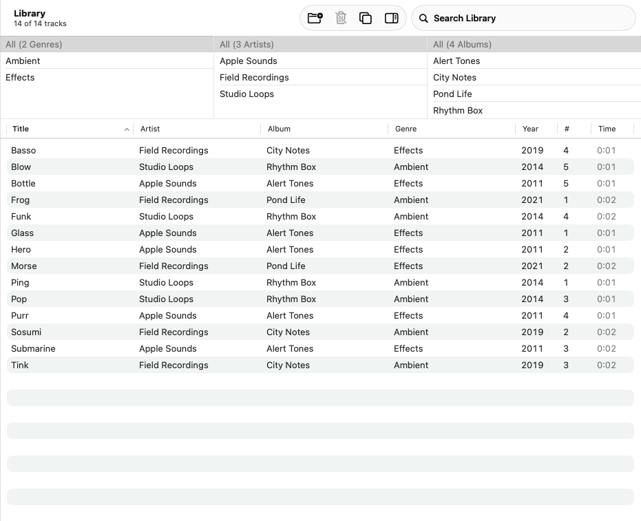 | 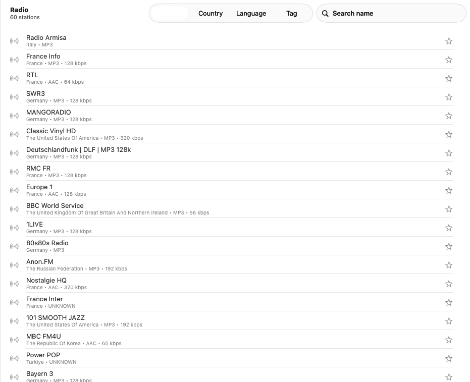 |
| La biblioteca con el navegador por columnas | Buscando radio por internet |
| 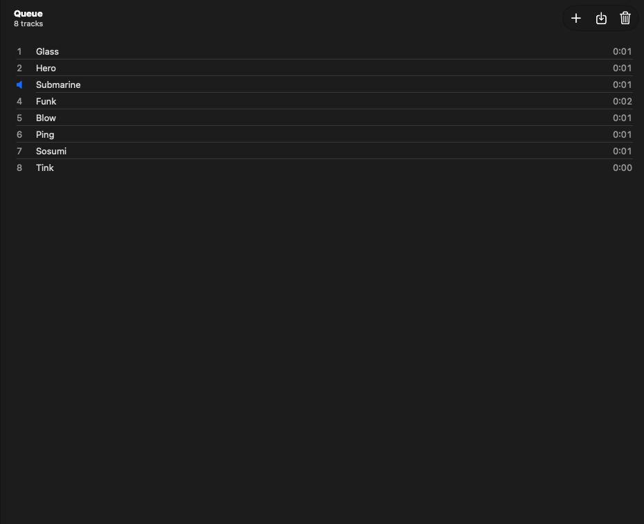 | 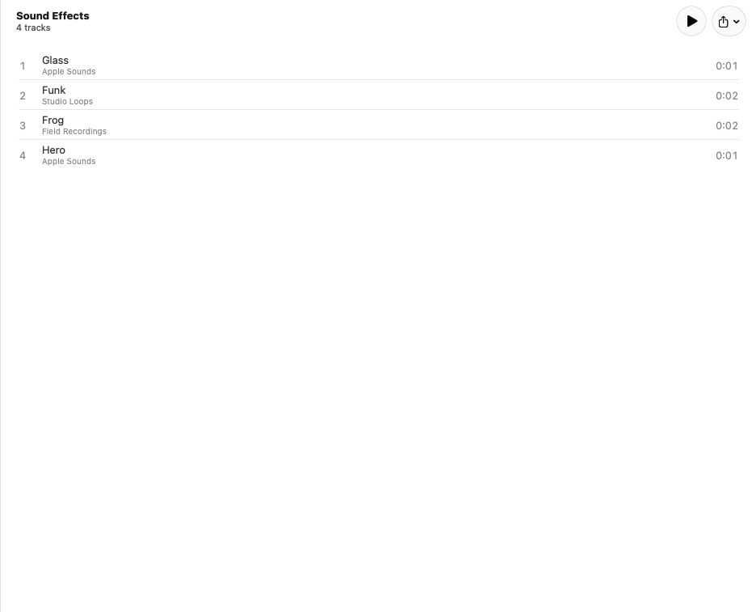 |
| La cola | Una lista de reproducción |
| 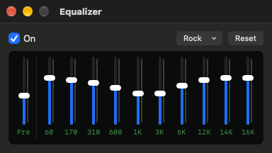 | 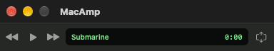 |
| El ecualizador | El reproductor como barra delgada |
| 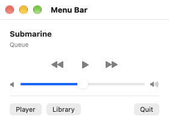 | 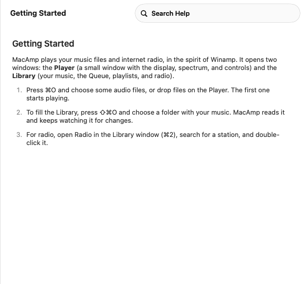 |
| El reproductor en la barra de menús | La ventana de Ayuda |

Ajustes:

| | | |
|---|---|---|
| 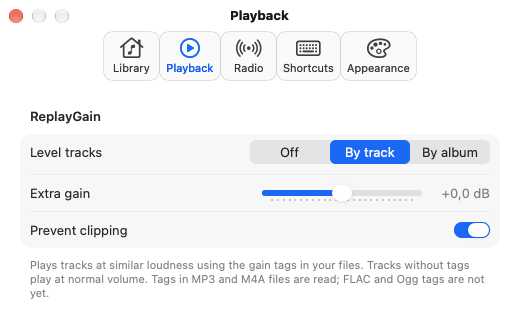 | 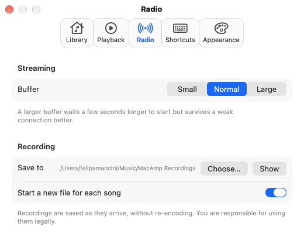 | 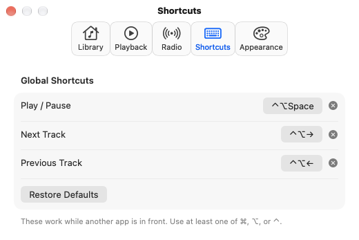 |
| 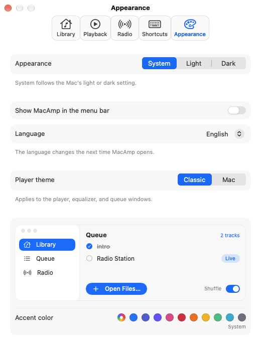 | 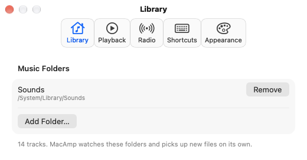 | 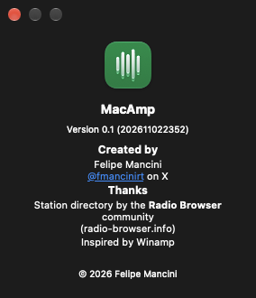 |

Las capturas están en inglés. La app se ve igual en español, con todos los textos traducidos.

## Compilar y ejecutar

Necesitas macOS 26 o posterior y el toolchain de Swift 6.2 (Xcode o las herramientas de línea de comandos). No hay proyecto de Xcode: es un paquete de Swift.

```bash
./build.sh --open      # compila, instala en ~/Applications/MacAmp.app y la abre
./build.sh             # compila e instala sin abrir
```

La app se firma con tu certificado de Apple Development si tienes uno, y ad hoc si no.

## Pruebas

```bash
swift test --scratch-path ~/Library/Developer/MacAmp/test-build   # tests unitarios de la lógica de MacAmpKit
tools/selftest.sh              # las pruebas de la app: reproducción, biblioteca, radio, grabación, atajos
tools/snap.sh                  # capturas de todas las ventanas en claro y oscuro (escribe en /tmp/MacAmp-shots)
tools/grid-lint.sh             # los números de espaciado deben estar en la cuadrícula de 4 pt
python3 tools/strings.py       # todo texto debe tener su traducción al español
```

El self-test reproduce audio real (con la salida silenciada) y, si hay conexión, emisoras reales.

## Cómo está hecha

- `Sources/MacAmpKit`: lógica sin interfaz ni audio, con tests unitarios: la cola, los títulos ICY, los archivos de listas, el ecualizador, el imán de ventanas, los duplicados y más.
- `Sources/MacAmp`: la app. `AVAudioEngine` reproduce archivos y emisoras decodificadas por una sola cadena (reproductor, ecualizador, unidad del espectro, volumen); SwiftData guarda la biblioteca, las listas, los favoritos y el historial.
- `docs/`: el brief, las historias de usuario, el plan de diseño, la revisión de arquitectura y un registro de errores con la regla que dejó cada uno.
- `design/DESIGN-SYSTEM.md`: los tokens (colores, radios, movimiento) que usa cada pantalla.
- `ARCHITECTURE.md`: las capas y las reglas.
- `Localization/`: los textos en inglés y español y la Ayuda.

## Límites

- Los archivos Ogg Vorbis y Opus no se reproducen, y las etiquetas no se pueden editar. Ambas cosas necesitan librerías de terceros, que este proyecto no usa.
- ReplayGain solo lee etiquetas MP3 y M4A.
- Las emisoras HLS suenan con un reproductor más simple: sin ecualizador, sin espectro y sin grabación.
- Aún sin probar a mano: arrastrar las ventanas del reproductor para pegarlas, el ítem en la barra de menús real, los atajos globales pulsados desde otra app y la carátula guardada dentro de las etiquetas.

## Créditos

Creado por Felipe Mancini ([@fmancinirt](https://x.com/fmancinirt) en X). Directorio de emisoras de la comunidad de Radio Browser. Inspirada en Winamp. MacAmp no está afiliada a Winamp.

## Licencia

MacAmp se publica bajo la [licencia BSD de 3 cláusulas](LICENSE). La lista de emisoras viene del servicio Radio Browser, que tiene sus propios términos; las transmisiones pertenecen a sus emisoras.
