# MacAmp

A music player for the Mac in the spirit of Winamp: a small player window with a spectrum and an equalizer, a library for your music files, playlists, and free internet radio with recording.

English | [Español](README.es.md)

<p align="center">
  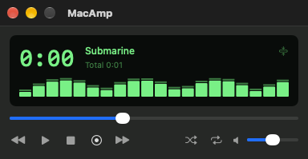
  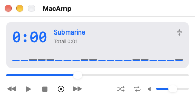
</p>

Written in Swift and SwiftUI for macOS 26 or later. It uses Apple's frameworks only: no third-party code.

## Features

**Playing**
- MP3, AAC, ALAC, FLAC, WAV, and AIFF files, with gapless playback between tracks of the same format.
- A queue you can reorder by dragging, with shuffle, repeat, and undo.
- A 10-band equalizer with a preamp and presets, and a live 20-bar spectrum.
- ReplayGain: tracks at similar loudness from the gain tags in MP3 and M4A files.
- Media keys, Now Playing in Control Center, and system-wide shortcuts that work while another app is in front.

**Library and playlists**
- Add music folders; MacAmp reads their tags and watches them for changes.
- Search, a Genre / Artist / Album column browser, sortable and customizable columns, an inspector with album art, and a duplicate finder.
- Playlists you can drag tracks into; import and export M3U, M3U8, and PLS.

**Internet radio**
- Search the free [Radio Browser](https://www.radio-browser.info) directory by name, country, language, or tag.
- Plays MP3 and AAC streams through the same equalizer, shows the song title the station reports, reconnects when the connection drops, and keeps a history of titles.
- Favorites, and adding a station by its address (a .pls or .m3u link works).
- Records a station to files without re-encoding, starting a new file for each song.

**The app**
- Two player themes (Classic and Mac), each in light and dark; light, dark, or follow the Mac.
- A thin "windowshade" mode, a menu bar player, and player windows that snap together.
- English and Spanish, with a Help window in both.

## Screenshots

The screenshots use sample data. The library and sidebar pages are cropped to the content area.

| | |
|---|---|
| 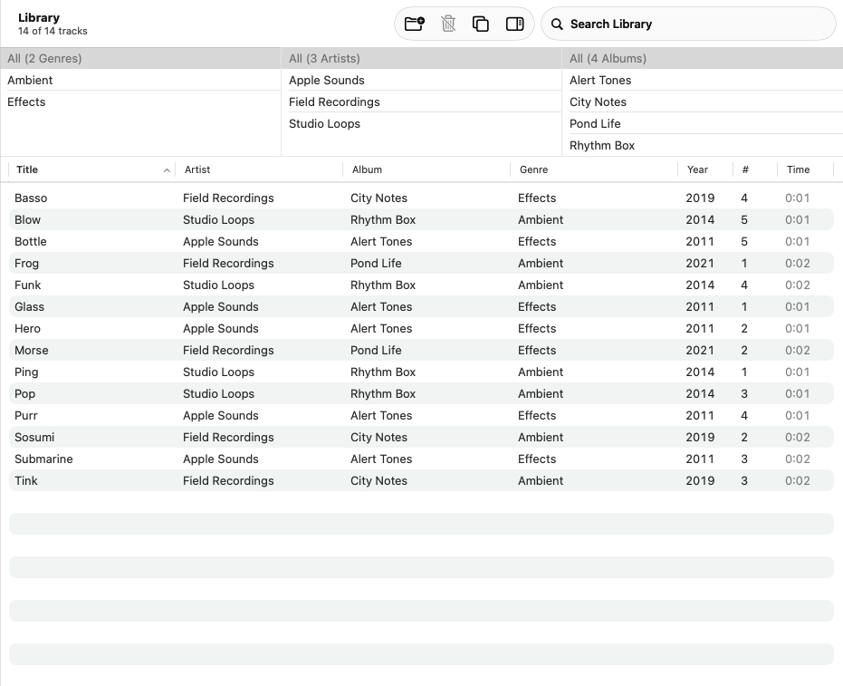 | 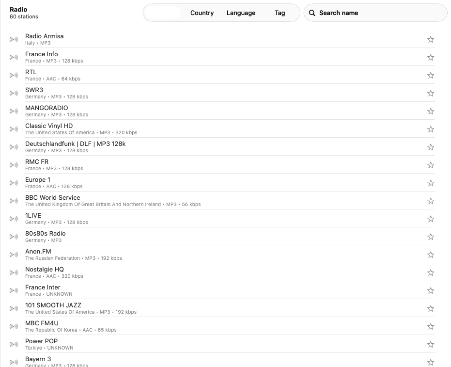 |
| The Library with the column browser | Searching internet radio |
| 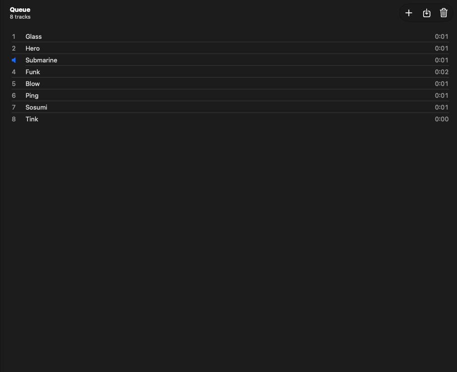 | 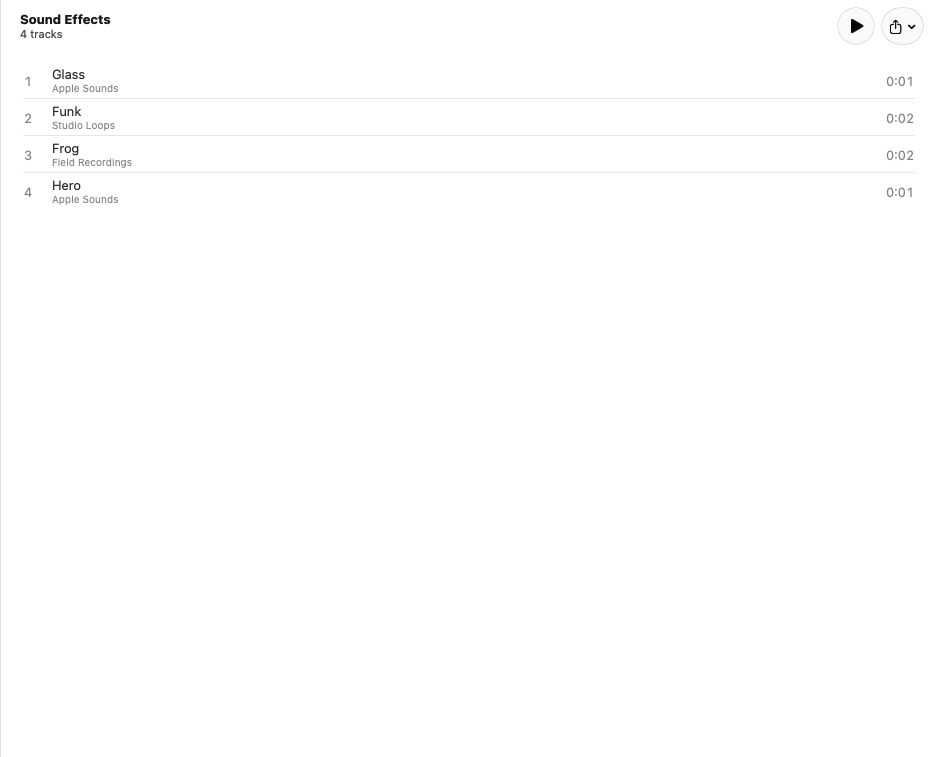 |
| The Queue | A playlist |
| 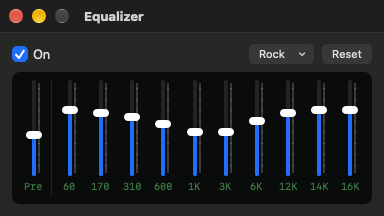 | 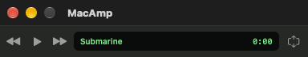 |
| The equalizer | The player as a thin bar |
| 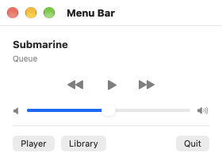 | 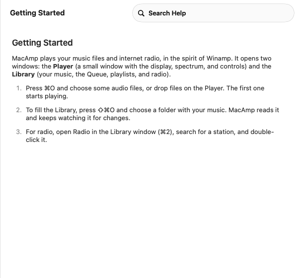 |
| The menu bar player | The Help window |

Settings:

| | | |
|---|---|---|
| 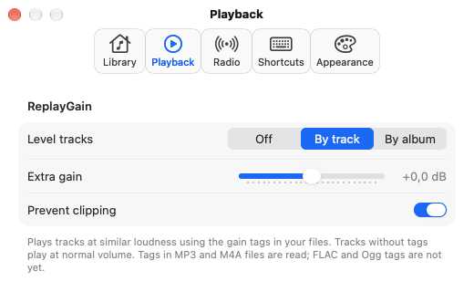 | 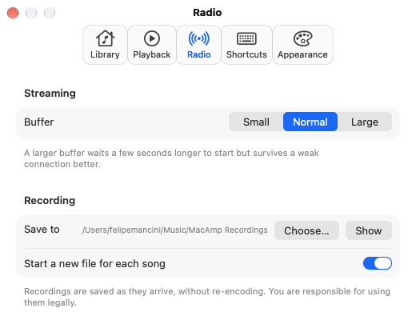 | 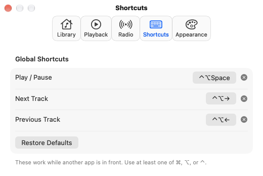 |
| 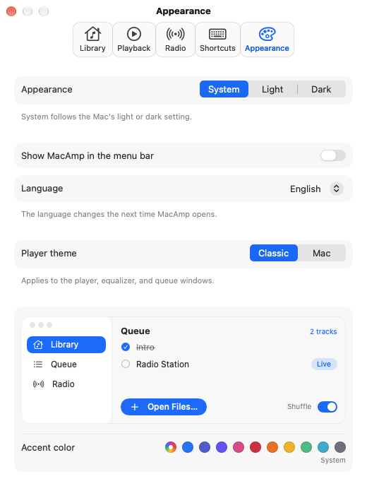 | 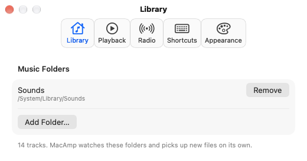 | 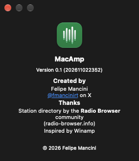 |

## Build and run

You need macOS 26 or later and the Swift 6.2 toolchain (Xcode or the command line tools). There is no Xcode project: it is a Swift package.

```bash
./build.sh --open      # build, install to ~/Applications/MacAmp.app, and open it
./build.sh             # build and install without opening
```

The app is signed with your Apple Development certificate if you have one, and ad hoc otherwise.

## Checks

```bash
swift test --scratch-path ~/Library/Developer/MacAmp/test-build   # unit tests for the logic in MacAmpKit
tools/selftest.sh              # the app's own checks: playback, library, radio, recording, shortcuts
tools/snap.sh                  # screenshots of every window in light and dark (writes /tmp/MacAmp-shots)
tools/grid-lint.sh             # spacing numbers must sit on the 4 pt grid
python3 tools/strings.py       # every text must have a Spanish translation
```

The self-test plays real audio (with the output muted) and, when it is online, real radio stations.

## How it is built

- `Sources/MacAmpKit`: logic with no UI or audio, with unit tests: the queue, ICY song titles, playlist files, the equalizer, window snapping, duplicates, and more.
- `Sources/MacAmp`: the app. `AVAudioEngine` plays files and decoded radio streams through one chain (player, equalizer, spectrum unit, volume); SwiftData stores the library, playlists, favorites, and history.
- `docs/`: the brief, the user stories, the design plan, the architecture review, and a fix log with the bugs found and the rule each one taught.
- `design/DESIGN-SYSTEM.md`: the tokens (colors, radii, motion) every screen uses.
- `ARCHITECTURE.md`: the layers and the rules.
- `Localization/`: English and Spanish texts and the Help.

## Limits

- Ogg Vorbis and Opus files do not play, and tags cannot be edited. Both need third-party libraries, which this project does not use.
- ReplayGain reads MP3 and M4A tags only.
- HLS radio streams play with a simpler player: no equalizer, no spectrum, no recording.
- Not yet tried by hand: dragging the player windows to snap, the menu bar item in the real menu bar, global shortcuts pressed from another app, and album art stored inside tags.

## Credits

Created by Felipe Mancini ([@fmancinirt](https://x.com/fmancinirt) on X). Station directory by the Radio Browser community. Inspired by Winamp. MacAmp is not affiliated with Winamp.

## Licence

MacAmp is released under the [BSD 3-Clause License](LICENSE). The station list comes from the Radio Browser service, which has its own terms; the radio streams belong to their stations.
